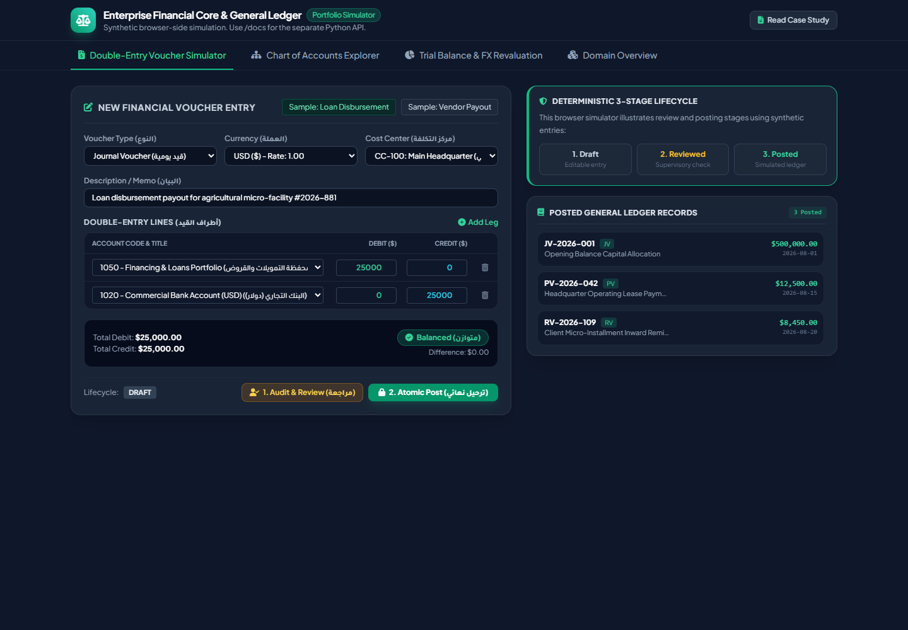

# Financial Ledger API — Python portfolio demo

[](https://github.com/mahmoodsufyan/financial-ledger-api/actions/workflows/tests.yml)
[](https://python.org)
[](LICENSE)

A small FastAPI/SQLAlchemy demonstration of double-entry voucher validation, review/post transitions, base-currency conversion and trial-balance reporting.

Built by **Mahmood Sufyan**, Oracle APEX & PL/SQL developer working on AI applications and Python backends. [Portfolio](https://mahmoodsufyan.github.io/) · [Related Oracle case study](docs/CASE_STUDY.md)

## Preview



The dashboard is a **browser-side simulator using synthetic data**, separate from the Python API. Its actions do not persist API vouchers. Open `/docs` to exercise the actual backend. The domain overview describes broader Oracle accounting concepts; it is not a list of implemented demo features.

## Implemented API behavior

- Chart of accounts and balanced voucher creation.
- `DRAFT → REVIEWED → POSTED` transitions; sequential repeat posting is rejected.
- Decimal input and SQLAlchemy `Numeric` money columns, with excess fractional digits rejected.
- Database-allocated voucher IDs used in unique human-readable voucher numbers.
- Conversion to USD with cumulative cent allocation on each journal side to preserve balance.
- Trial balance and a simple loan-disbursement bridge.

## Local setup

Use Python 3.11 or newer, create a virtual environment, then:

```bash
pip install -r requirements.txt
uvicorn app.main:app --host 127.0.0.1 --port 8000
```

Local URLs after startup: [dashboard](http://127.0.0.1:8000/), [API docs](http://127.0.0.1:8000/docs), [health](http://127.0.0.1:8000/health).

Alternatively, `docker compose up --build` binds port 8000 to localhost. These are local preview addresses, not hosted public demos.

## Example: create, review and post a voucher

Send `POST /api/v1/vouchers/` with this JSON using `/docs` or an HTTP client:

```json
{
  "memo": "Synthetic cash transfer",
  "currency": "USD",
  "exchange_rate": "1.00000000",
  "lines": [
    {"account_code": "1010", "debit_amount": "12.34"},
    {"account_code": "1020", "credit_amount": "12.34"}
  ]
}
```

The response includes an allocated `id`, a number such as `JV-YYYYMM-00000001`, `status: "DRAFT"`, and `total_amount: "12.34"`. Then call `POST /api/v1/vouchers/{id}/review` and `POST /api/v1/vouchers/{id}/post`. Decimal response fields are JSON strings to preserve precision.

Amounts use at most two decimal places. Supported currencies are USD, EUR, GBP, SAR, AED and YER; currencies with other minor-unit conventions are deliberately excluded. The base currency is USD. Exchange rates accept up to eight fractional digits, below 10,000. Voucher totals must be below one trillion units. `1.004`, negative/non-finite amounts and unsupported currencies return validation errors.

## Tests and CI

```bash
python -m pytest -q
```

Tests use a disposable database, never an existing `ledger.db`. GitHub Actions runs the suite on Python 3.11 and 3.13. Regression coverage includes sub-cent rejection, decimal round trips, split-line FX rounding, sequential repeat-post rejection and concurrent voucher creation. This does not establish production-grade concurrent posting safety.

## Boundaries and storage compatibility

- This is a local portfolio demo. Authentication, RBAC and segregation of duties are **not implemented**. Reviewer/poster names are demonstration inputs, not verified identities.
- Input and service checks enforce the demonstrated balance rules; there is no database constraint guaranteeing cross-row voucher balance against direct database writes.
- SQLite is the default demonstration database. Its numeric affinity does not provide PostgreSQL-style native fixed-decimal guarantees. PostgreSQL integration and production concurrency are not certified by these SQLite tests.
- The bridge does not implement retry idempotency. Fiscal closing, FX revaluation, compliance controls and immutable audit storage are outside the demo scope.
- Schema changes are for a fresh demo database. `create_all()` does not migrate an existing database. Preserve any existing database and use a new `DATABASE_URL` for this version; no destructive migration/reset is supplied.
- The original Oracle application and company data are private. The related case study is an anonymized overview, not a claim that this demo contains the enterprise system.
