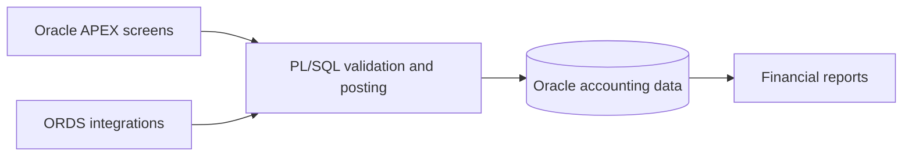

# Oracle APEX accounting and general-ledger workflows

## Context and ownership

This is an anonymized overview of my Oracle APEX, PL/SQL and ORDS work on financial applications. The original company source code, customer data and production environment remain private.

This repository contains a separate Python/FastAPI portfolio demo. It is not the original Oracle system and does not implement every capability discussed in the Oracle overview.

## My contribution

My work covered relational database design, PL/SQL business packages, Oracle APEX screens, voucher workflows, accounting-related integrations and reporting. These are project responsibilities; official employment titles remain as recorded in my CV and experience certificate.

## Functional areas

- Chart of accounts and accounting reference data.
- Journal vouchers, receipts and disbursements.
- Review and posting workflows for accounting transactions.
- Currency-related financial processing and reports.
- Accounting integration with operational workflows.

## Architecture overview

The diagram is conceptual. It does not disclose private schemas or establish that the public demo has production access controls, database-enforced cross-row balance guarantees or regulatory certification.

## Public demo scope

The API demonstrates balanced voucher input, a draft/review/post lifecycle, journal persistence, base-currency conversion and trial-balance aggregation. Its dashboard is a separate browser-side simulator with synthetic data; use `/docs` to exercise the actual API.

The demo does not implement enterprise RBAC, segregation of duties, period closing, exchange revaluation, immutable audit storage or full integration idempotency. See the [README](../README.md) for supported currencies and storage limitations.

## Evidence and outcomes

The Oracle work addressed structured accounting workflows and reporting. There are no published measurements here supporting percentage improvements, hours saved, zero-error operation or real-time fiscal closings. Those claims are intentionally omitted.

Page counts are not business-module counts. A verified inventory would be needed before publishing either as a scope metric.

- [Voucher validation](../app/schemas/voucher.py)
- [Posting and reporting service](../app/services/ledger_service.py)
- [Models](../app/db/models.py)
- [Regression tests](../tests)
