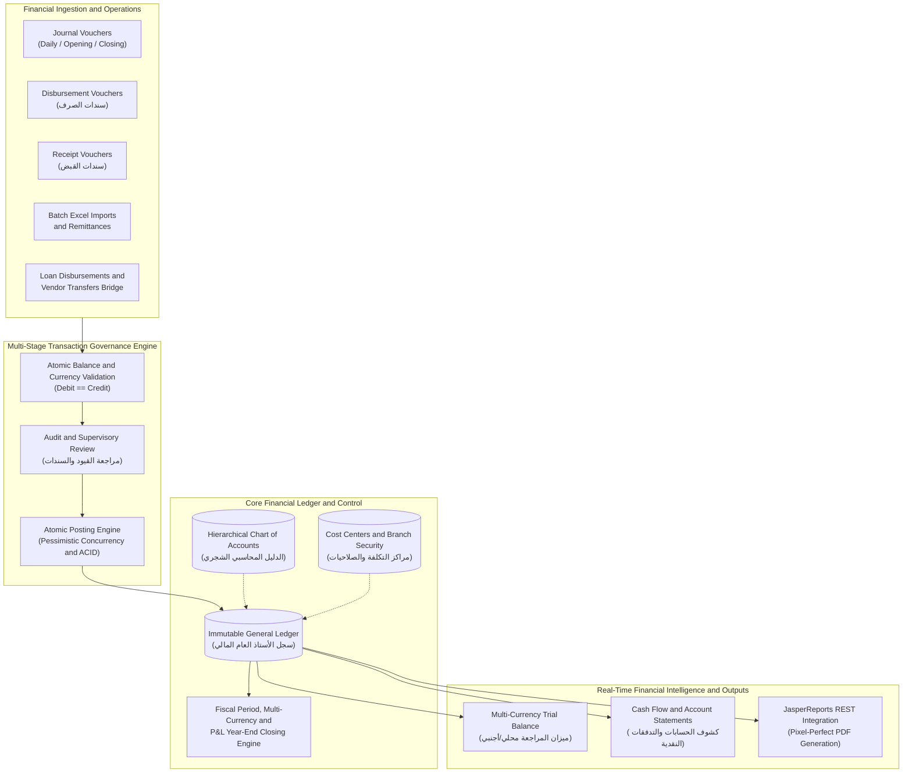

# 🏛️ Engineering Case Study: Enterprise Multi-Currency Financial Accounting & General Ledger System

> **Project Classification:** Enterprise Production System (Financial Institution) → **Anonymized Case Study**  
> **Architecture:** Multi-Tier Transactional Accounting Engine & Core General Ledger  
> **Scope:** 74 Enterprise Modules & Screens handling double-entry journals, multi-stage voucher lifecycle, multi-currency ledger, cost-center governance, and automated loan/remittance postings.

---

## 1. Executive Summary

An enterprise-grade **Multi-Currency General Ledger, Voucher Management, and Financial Operations Platform** engineered to govern the end-to-end accounting lifecycle for credit and microfinance institutions. The platform enforces strict double-entry balancing rules, multi-stage approval and posting workflows (`Draft` ➔ `Review` ➔ `Post`), hierarchical chart of accounts, dynamic cost-center permission segregation, and automated posting pipelines bridging loan disbursements, vendor remittances, and digital payment transactions into the core general ledger.



---

## 2. Business Context & Problem Statement

Financial and credit institutions process hundreds of daily multi-branch transactions spanning customer cash repayments, vendor payouts, loan portfolio disbursements, and foreign currency exchanges. Prior to implementing this unified financial engine, the organization faced critical operational and regulatory challenges:

1. **Voucher Posting Inconsistencies & Human Error:** Manual data entry without strict database-enforced transactional barriers created risks of unbalanced journal entries, mismatched debit/credit legs, and unverified voucher approvals.
2. **Multi-Currency & Exchange Rate Volatility:** Transactions conducted across multiple foreign currencies required continuous tracking of fluctuating exchange rates, automatic calculation of currency conversion differences, and compliant period-end revaluations.
3. **Decoupled Loan & Accounting Systems:** Credit facility disbursements and vendor remittances were processed in operational systems and required time-consuming manual journalizing, leading to ledger lag and reconciliation discrepancies.
4. **Strict Audit & Segregation of Duties:** Regulatory standards demanded complete segregation between voucher creators, reviewers, and posting supervisors, combined with branch-level and cost-center-level data isolation.

---

## 3. My Role & Key Responsibilities

As the **Lead Database & Backend Systems Engineer (Oracle APEX, PL/SQL & ORDS REST Services)**, I architected and implemented the core financial engine and transactional workflows:

* **Core Accounting Architecture:** Designed the normalized relational schema for the multi-tier general ledger, journal vouchers, payment/receipt slips, and cost center hierarchies.
* **Deterministic 3-Stage Posting Pipeline:** Engineered the transactional state machine (`Draft` ➔ `Review` ➔ `Post`) ensuring zero unposted or imbalanced transactions reach the general ledger.
* **Automated Integration Bridge:** Built automated PL/SQL posting procedures that listen to loan disbursements, vendor settlements, and Excel batch uploads to generate atomic balanced vouchers automatically.
* **Multi-Currency Closing Engine:** Programmed automated period-end procedures for calculating currency gains/losses, fiscal year rollover, and profit & loss closures.
* **Granular RBAC & Branch/Cost-Center Isolation:** Implemented security schemes and dynamic authorization logic restricting voucher approval and cost center allocation per user role and branch.

---

## 4. System Architecture & Core Modules

The application encompasses **74 comprehensive pages and modules** categorized into 6 core domains:

```
├── 1. Journal & Voucher Management (القيود وسندات الصرف والقبض)
│   ├── Daily Journal Vouchers (القيود اليومية) [Pages 2, 5]
│   ├── Opening Journal Entries (القيود الإفتتاحية) [Pages 10, 13]
│   ├── Accounting Adjustment Vouchers (القيود المحاسبية) [Pages 22]
│   ├── Payment & Disbursement Vouchers (سندات الصرف) [Pages 6, 7]
│   └── Cash Receipt Vouchers (سندات القبض) [Pages 14, 15]
│
├── 2. Verification & Multi-Stage Posting Engine (المراجعة والترحيل)
│   ├── Voucher Audit & Review (مراجعة القيود، سندات الصرف، والقبض) [Pages 11, 12, 16, 18, 23]
│   └── Atomic Posting Engine (ترحيل القيود، سندات الصرف، والقبض) [Pages 19, 20, 21, 24, 25]
│
├── 3. Chart of Accounts & Cost Centers (الدليل ومراكز التكلفة)
│   ├── Multi-Tier Chart of Accounts (الدليل المحاسبي الشجري) [Pages 29, 30]
│   ├── Bank Accounts & Financial Institutions (حسابات البنوك) [Page 28]
│   ├── Cost Center Directory (مراكز التكلفة) [Pages 41, 42]
│   └── Account & Cost Center Authorizations (صلاحيات وربط مراكز التكلفة) [Pages 3, 4, 31, 55, 56]
│
├── 4. Automated Operations & Loan Integration (العمليات والتمويلات الآلية)
│   ├── Issued Financing & Vendor Transfers (التمويلات المصدرة وحوالات الموردين) [Pages 43, 53]
│   ├── Automated Supply & Inward Voucher Bridge (إثبات قيود التوريدات الآلية) [Page 50]
│   └── Remittance Management & Excel Batch Importer (الحوالات واستيراد إكسل) [Pages 45, 46, 47, 52]
│
├── 5. Closings & Multi-Currency Management (الإقفالات والعملات)
│   ├── Multi-Currency & Exchange Rate Engine (شاشة العملات وأسعار الصرف) [Pages 39, 40]
│   ├── Fiscal Years & Period Management (السنوات المالية) [Pages 35, 38]
│   ├── Currency Revaluation & Exchange Closing (إقفال العملات) [Page 27]
│   ├── Opening Balances Rollover (إقفال الأرصدة الإفتتاحية) [Page 36]
│   └── Profit & Loss Year-End Closing (إقفال الأرباح والخسائر) [Page 26]
│
└── 6. Financial Intelligence & Reporting (التقارير والميازين)
    ├── Multi-Currency Trial Balance (كشوفات الميازين وميزان المراجعة) [Pages 9, 32]
    ├── Account Statement & Ledger Explorer (كشف الحساب) [Page 17]
    ├── Cash Flow Analytics (تقرير التدفقات النقدية) [Page 54]
    └── Vendor & Ledger Transaction Reports (تقارير الموردين والقيود) [Pages 37, 57]
```

---

## 5. Key Engineering Challenges & Solutions

### Challenge 1: Ensuring 100% Atomic Balance in High-Volume Double-Entry Posting
* **Problem:** High concurrent voucher entries from multiple distributed branch accountants risked partial writes, leading to unbalanced transactions (Sum(Debit) != Sum(Credit)).
* **Engineering Solution:**
  * Enforced double-entry integrity at the lowest database tier via table constraints and PL/SQL package validation.
  * Implemented pessimistic locking (`SELECT ... FOR UPDATE`) during posting execution to guarantee that accounts and sub-ledgers cannot be altered concurrently while a voucher is transitioning to the `POSTED` state.

```sql
-- Example Architectural Logic: Atomic Voucher Posting Guard
PROCEDURE post_journal_voucher(p_voucher_id IN NUMBER, p_user_id IN VARCHAR2) IS
    v_debit_total  NUMBER := 0;
    v_credit_total NUMBER := 0;
    v_status       VARCHAR2(20);
BEGIN
    -- 1. Lock voucher header and verify state
    SELECT status INTO v_status 
    FROM fin_journal_headers 
    WHERE voucher_id = p_voucher_id 
    FOR UPDATE;
    
    IF v_status != 'REVIEWED' THEN
        RAISE_APPLICATION_ERROR(-20001, 'Voucher must be reviewed before posting.');
    END IF;
    
    -- 2. Verify strict balance across all detail legs
    SELECT NVL(SUM(debit_amount), 0), NVL(SUM(credit_amount), 0)
    INTO v_debit_total, v_credit_total
    FROM fin_journal_lines
    WHERE voucher_id = p_voucher_id;
    
    IF v_debit_total != v_credit_total OR v_debit_total <= 0 THEN
        RAISE_APPLICATION_ERROR(-20002, 'Transaction out of balance or zero sum.');
    END IF;
    
    -- 3. Execute atomic posting to General Ledger
    INSERT INTO fin_general_ledger (...)
    SELECT ... FROM fin_journal_lines WHERE voucher_id = p_voucher_id;
    
    -- 4. Mark voucher as posted with immutable audit log
    UPDATE fin_journal_headers 
    SET status = 'POSTED', posted_by = p_user_id, posted_at = SYSDATE 
    WHERE voucher_id = p_voucher_id;
END;
```

---

### Challenge 2: Multi-Currency Revaluation and Cross-Currency Closings
* **Problem:** Holding balances across local and foreign currencies created discrepancy risks when generating consolidated financial statements during currency fluctuations.
* **Engineering Solution:**
  * Built a dual-ledger calculation mechanism storing every transaction in its **Transaction Currency (TC)** and **Base/Functional Currency (BC)** at the historical spot rate.
  * Developed an automated Period-End Currency Revaluation Engine that calculates unrealized foreign exchange gains/losses and posts adjusting balancing entries before generating Trial Balances.

---

### Challenge 3: Seamless Integration with Loan Origination & Vendor Remittances
* **Problem:** Loan approvals and supplier payouts generated thousands of manual voucher requests, resulting in administrative backlog and data synchronization delays.
* **Engineering Solution:**
  * Engineered an **Automated Posting Bridge** (إثبات قيود التوريدات والتمويلات الآلية).
  * When a loan contract is disbursed or a supplier remittance is approved in the operational system, the event triggers an idempotent background PL/SQL pipeline that builds the corresponding balanced journal entry and links it directly to the loan ID for bidirectional traceability.

---

## 6. Technology Stack

| Layer / Domain | Technologies & Frameworks |
| :--- | :--- |
| **Database Engine** | Oracle Database Enterprise Edition (PL/SQL Packages, Table Triggers, Analytical Views, Database Scheduler) |
| **Application UI** | Oracle Application Express (APEX 20.x+) — 74 Functional Screens & Administration Pages |
| **API & Reporting** | Oracle REST Data Services (ORDS), JasperReports Server REST API (PDF Engine), Dynamic SQL |
| **Security & Auditing** | Granular RBAC, Cost-Center Access Control Matrices, Immutable Audit Logs, Session Authorization Schemes |
| **Data Ingestion** | Batch Excel / CSV Parsing Engine, Automated Staging Tables |

---

## 7. Operational & Business Impact

* **100% Elimination of Imbalanced Postings:** Complete programmatic prevention of single-sided or out-of-balance vouchers across all branches.
* **Multi-Branch Real-Time Closing:** Reduced the monthly and annual fiscal closing cycle from multiple days to real-time automated execution.
* **Automated Operational Reconciliation:** Integrated automatic posting for loan disbursements and remittances, eliminating hundreds of hours of manual accounting entry each month.
* **Pixel-Perfect Regulatory Compliance:** Instant, on-demand generation of official Trial Balances, Cash Flow statements, and audit reports for central bank and regulatory audits.

---

## 8. Summary for Resume & Professional Profiles

### 💼 Resume Bullet Points:
* *Architected and engineered a 74-module Enterprise Financial Accounting & General Ledger system handling multi-currency double-entry transactions and real-time trial balance reporting.*
* *Designed a 3-stage voucher posting state machine (`Draft` ➔ `Review` ➔ `Post`) with database-enforced ACID guarantees, eliminating 100% of out-of-balance entries.*
* *Implemented automated PL/SQL posting bridges connecting loan disbursements and vendor remittances directly into the general ledger.*
* *Built multi-currency period closing engines with automated exchange difference revaluation and dynamic cost-center role-based access control.*

### 🌐 LinkedIn Featured Project Blurb:
> **Enterprise Multi-Currency Financial & General Ledger Platform**  
> Architected a 74-module enterprise financial accounting system handling high-volume daily transactions, multi-currency ledger management, and automated period closings. Features a rigorous 3-tier voucher posting lifecycle, automated bridges for credit disbursements and vendor remittances, dynamic cost-center governance, and real-time financial reporting integration.